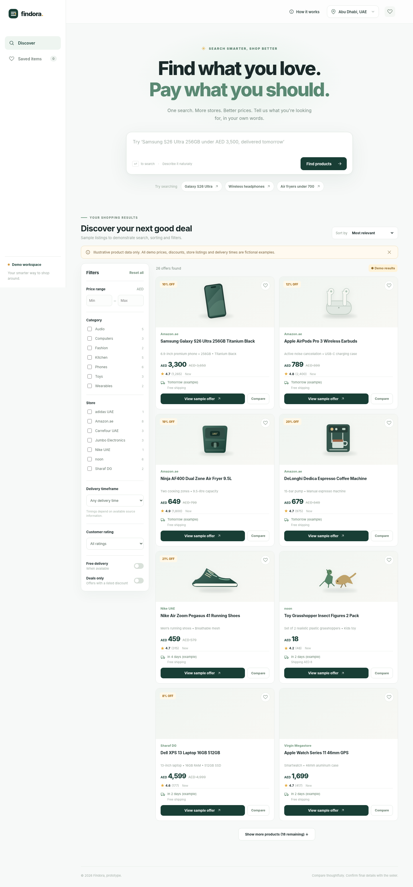

# Findora · AI Product Finder

A responsive product-search MVP with a ChatGPT-style input, product offer cards, filters, sorting, bookmarks, comparisons and an optional Google Shopping discovery integration for the UAE.

> **Status: MVP / demonstration.** It works out of the box with **fictional sample offers**. Live discovery requires a SerpApi key and is not proof of store stock, final price, or delivery to a particular address. This app does **not** crawl every online store.



[Mobile preview](docs/screenshots/mobile.png)

## Quick start

**Requirements:** Node.js 20 or later (Node.js 22 recommended). No third-party npm packages or build step are required.

```bash
npm ci
npm start
```

Open **http://localhost:3000**. You can search immediately using demo offers without an API key.

### Optional: connect live shopping results

1. Get a SerpApi key for [Google Shopping](https://serpapi.com/google-shopping-api).
2. Copy `.env.example` to `.env`:

   ```bash
   cp .env.example .env
   ```

   On Windows PowerShell, use `Copy-Item .env.example .env`.
3. Put `SERPAPI_API_KEY=your_key_here` in `.env` (do not commit this file).
4. Restart `npm start`. The live mode will then be available for a search.

The API key stays server-side. Search-provider requests may use paid API credits.

## What works

- Natural-language search, including price ceilings, ratings, delivery preferences and categories.
- Product cards with title, image, merchant, AED price, rating and available delivery text.
- Desktop two-column results with a mobile-friendly one-column layout.
- Search filtering and sorting by price, relevance, rating, shipping, merchant and other options.
- Saved items stored locally in the browser, plus comparisons of up to three offers.
- Location selector for supported UAE cities; browser geolocation only with permission.
- Sample data without credentials, or optional SerpApi-based Google Shopping discovery.
- Test suite, safe example configuration and GitHub Actions CI.

## Important limitations

| Capability | Demo mode | Live discovery mode |
| --- | --- | --- |
| Product offers | 26 fictional samples | Search-provider-reported offers |
| Prices / merchants | Illustrative only | Source-reported, may change |
| Delivery dates | Illustrative only | Source text where provided, otherwise unknown |
| Checkout eligibility by exact address | Not verified | Not verified; confirm with merchant |
| Every UAE or international store | No | No; limited to source coverage |

Location is used to select a **city**, not to verify shipping to an exact address. The frontend never sends the user's raw coordinates to the shopping provider. Do not treat any displayed delivery estimate as a guarantee.

## Project layout

```text
.
├── .github/
│   ├── workflows/ci.yml       # Tests on pushes and pull requests
│   └── ISSUE_TEMPLATE/        # Bug reports and feature requests
├── docs/
│   ├── screenshots/           # Desktop and mobile previews
│   ├── DEPLOYMENT.md          # Deployment instructions
│   └── TESTING.md             # Tests and browser smoke checks
├── public/
│   ├── index.html             # Accessible search / compare UI
│   ├── styles.css             # Responsive styles
│   ├── app.js                 # Client-side search / filter logic
│   └── assets/                # Local example SVG illustrations
├── server/
│   ├── index.js               # HTTP API + static file server
│   ├── search.js              # Query parser and source adapter
│   └── demo-data.js           # Clearly fictional offers
├── tests/                     # Node.js built-in tests
├── scripts/                   # Optional tools and browser checks
├── .env.example               # Non-secret config template
├── package.json
└── package-lock.json
```

### API endpoints

| Endpoint | Use |
| --- | --- |
| `GET /api/health` | Health check |
| `GET /api/config` | Locations and provider availability (never credentials) |
| `GET /api/search?q=Samsung&city=Abu%20Dhabi&mode=demo` | Demo results |
| `GET /api/search?q=Samsung&city=Dubai&mode=live` | Live provider if configured |

Live discovery has a timeout, a short in-memory cache, and per-IP rate limits. Those protections are suitable for initial experimentation, not hardened public deployment.

## Testing

```bash
npm run ci
```

The checks run without credentials or external shopping API requests. GitHub Actions repeats them on Node.js 20 and 22 for each push and pull request. Details: [Testing guide](docs/TESTING.md).

## Publish on GitHub

1. Create an empty GitHub repository, for example `findora-product-finder` (**private** is recommended initially).
2. From this folder run:

   ```bash
   git init -b main
   git add .
   git commit -m "Initial Findora MVP"
   git remote add origin https://github.com/YOUR_USERNAME/findora-product-finder.git
   git push -u origin main
   ```

3. Open your repository's **Actions** tab. The `CI` workflow should run automatically. The commands above require that Git authentication is configured.

Do **not** add `.env` or credentials to the repository. The package is marked `private` to prevent accidental publication to the npm registry; GitHub repository visibility is controlled separately.

For a deployment that serves both the frontend and API, see the [deployment guide](docs/DEPLOYMENT.md). **GitHub Pages alone cannot run this Node.js server.**

## Development and security

- [Contributing](CONTRIBUTING.md)
- [Security policy](SECURITY.md)
- [Deployment](docs/DEPLOYMENT.md)
- [Testing](docs/TESTING.md)

**Licensing:** No open-source license is assigned by default. Before making this a public reusable project, choose a license that matches how you want others to use the code.

## Planned improvements

Expand authorized merchant integrations, more precise product matching, address-level shipping verification where available, structured LLM query interpretation, and production-grade rate limiting/monitoring.
